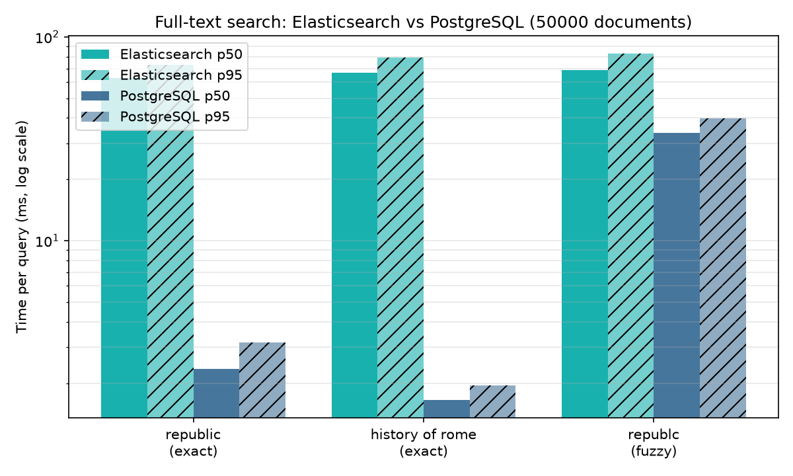

# Pinakes 2.0 : rapport, sections 1 à 3 (brouillon de Meryem)

> Brouillon écrit pour être complété. Chaque `[A REMPLIR : ...]` est un chiffre, une capture ou une
> phrase à remplacer par ce que **vous avez réellement mesuré**. Les chiffres viennent de
> `python -m benchmarks.es_vs_postgres.report_numbers` et des fichiers
> `benchmarks/es_vs_postgres/results/`. Relisez tout avec vos mots : c'est votre rapport.
> Quand il ne reste plus aucune marque, supprimez ce bloc.

---

## 1. L'idée et l'histoire

### 1.1 Les Pinakes de Callimaque

À Alexandrie, au IIIe siècle avant notre ère, le poète et érudit Callimaque de Cyrène, qui travaillait
pour la Bibliothèque, a dressé les *Pinakes* (« tables »). C'est considéré comme le premier catalogue
de bibliothèque connu. D'après la tradition, les œuvres y étaient rangées **par genre** (poètes,
philosophes, historiens, orateurs, médecins, législateurs...), puis **par auteur**, avec pour chaque
auteur une courte biographie et, pour chaque œuvre, son titre et ses premiers mots (l'*incipit*), qui
servaient à reconnaître un rouleau. Les *Pinakes* ne nous sont parvenus que par fragments et par des
citations d'auteurs plus tardifs ; les détails (comme le nombre de rouleaux) varient selon les sources,
il faut donc les présenter avec prudence. [A REMPLIR : vérifiez deux sources avant de citer un chiffre.]

### 1.2 Notre version moderne

Nous avons construit une version moderne : un catalogue de bibliothèque d'œuvres anciennes et classiques,
tiré du catalogue du Projet Gutenberg. Le point de départ du projet est simple : **chaque sorte de
question va vers la base de données qui y répond le mieux**. On parle de *persistance polyglotte*.

| Base | Ce qu'elle fait dans le projet | Pourquoi elle |
|---|---|---|
| MongoDB | stocke le catalogue : œuvres, auteurs, genres | documents flexibles, la biographie de l'auteur est dans l'œuvre |
| Elasticsearch | recherche avec fautes de frappe, autocomplétion, filtres | index inversé, classement par pertinence |
| Redis | cache de 60 secondes et liste des « plus lus » | très rapide, ensemble trié |
| Neo4j | qui a influencé qui, plus court chemin entre deux auteurs | parcours de liens sans jointures |
| Cassandra | événements de lecture (qui a lu quoi, quand) | beaucoup d'écritures |
| ELK (Logstash, Kibana) | journaux de l'API, tableau de bord, alerte contre un robot | analyse de logs |
| FastAPI et Streamlit | l'API et les pages web | une seule porte d'entrée |

### 1.3 Organisation du travail

Nous sommes deux, avec le même volume de travail (34 points chacun, environ 17 heures). Le plan tient
en 7 jours : installation et contrats le jour 1, données le jour 2, recherche, événements et logs
le jour 3, cache, tableau de bord et alerte le jour 4, pages et intégration le jour 5, mesures et
rapport le jour 6, présentation le jour 7. Meryem s'est occupée du catalogue et de la recherche
(MongoDB, Elasticsearch, Redis), Hadil des relations et de la surveillance (Neo4j, Cassandra, ELK).
[A REMPLIR : une phrase sur ce que vous avez appris de ce découpage, par exemple « les contrats d'API
gelés dès le jour 1 nous ont évité de nous bloquer l'une l'autre ».]

---

## 2. Architecture

### 2.1 Vue d'ensemble

```
 Navigateur
     |
 Streamlit (pages : Search, Browse, Popular, Graph, Events, Monitoring)      port 8501
     |
 FastAPI (un routeur par domaine)                                           port 8000
     |-- MongoDB          catalogue                                         port 27017
     |-- Elasticsearch    recherche (index « works »)                       port 9200
     |-- Redis            cache et « plus lus »                             port 6379
     |-- Neo4j            influences                                        ports 7474 et 7687
     |-- Cassandra        événements de lecture                             port 9042
     '-- logs/api.log --> Filebeat --> Logstash (5044) --> Elasticsearch (logs, 9201) --> Kibana (5601)
```

[A REMPLIR : remplacez ce schéma par un dessin propre (draw.io, par exemple) pour le rapport et les
diapositives.]

### 2.2 Deux piles Docker

Tout lancer demande environ 7 Go de mémoire, ce qui est trop pour un portable pendant le développement.
Nous avons donc **deux piles** : la pile A (MongoDB, Elasticsearch du catalogue, Redis) et la pile B
(Neo4j, Cassandra, Elasticsearch des logs, Kibana, Logstash, Filebeat). Chacun lance seulement la
sienne ; on lance tout ensemble pour la démonstration. Deux instances d'Elasticsearch tournent donc :
une pour le catalogue (port 9200), une pour les logs (port 9201), pour ne pas mélanger des usages très
différents.

### 2.3 Les contrats

Le jour 1, nous avons **gelé** trois fichiers : `schema_work.json` (le format d'une œuvre), `api.md`
(la liste des endpoints et leurs réponses) et `ports.md`. Toute modification demande l'accord des deux.
Résultat : l'une peut écrire la page Search pendant que l'autre écrit l'API Neo4j, sans jamais se
bloquer. Une œuvre ressemble à ceci :

```json
{ "_id": "w_0003", "title": "The Republic", "incipit": "I went down yesterday to the Piraeus ...",
  "genre": "philosophy",
  "authors": [ { "id": "a_plato", "name": "Plato", "birth_year": -428, "bio": "..." } ],
  "language": "en", "year": -375, "subjects": ["Political science"], "source": "gutenberg" }
```

| Domaine | Endpoints |
|---|---|
| Catalogue | `GET /catalog/genres`, `/catalog/genres/{genre}/authors`, `/catalog/works/{id}` |
| Recherche | `GET /search`, `GET /suggest` |
| Plus lus | `GET /popular` |
| Graphe | `GET /graph/path`, `/graph/neighbors/{id}`, `/graph/influence/top` |
| Événements | `POST /events/read`, `GET /events/work/{id}`, `GET /events/user/{id}` |
| Surveillance | `GET /monitoring/alerts` |

### 2.4 Organisation du code

Chacune possède ses dossiers et ne modifie jamais les fichiers de l'autre. Les rares fichiers communs
(`docker-compose.yml`, `.env.example`, `backend/app/main.py`, `requirements/base.txt`) ne changent que
par une pull request approuvée par l'autre. Le fichier `main.py` enregistre dès le jour 1 les six
routeurs, et chaque page web est un fichier séparé : personne n'édite jamais le même fichier que
l'autre. Les fusions se font en « squash » avec approbation.

### 2.5 Où se placent MongoDB, Elasticsearch et Redis sur le triangle CAP

Le théorème CAP (Brewer, 2000 ; preuve de Gilbert et Lynch, 2002) dit qu'un système distribué ne peut
pas garantir à la fois la cohérence (C), la disponibilité (A) et la tolérance aux partitions (P). Quand
le réseau se coupe, il faut choisir entre C et A. **Ces étiquettes sont discutées** : elles décrivent
une configuration, pas un produit, et dans notre projet chaque base tourne sur un **seul nœud**. Il n'y
a donc aucune partition réelle : nous raisonnons sur ce que ferait chaque base en cluster.

- **MongoDB : plutôt CP.** Dans un jeu de réplicas, une seule copie (le primaire) accepte les
  écritures. Si le réseau se coupe, la partie minoritaire ne peut plus élire de primaire et n'accepte
  plus d'écritures : on préserve la cohérence au prix de la disponibilité. Choix adapté : le catalogue
  est la **source de vérité** de tout le reste, une œuvre ne doit pas exister en deux versions.
- **Elasticsearch : plutôt CP pour les écritures, avec des lectures à terme.** Un nœud maître est
  élu à la majorité ; une écriture doit atteindre le shard primaire. Mais une recherche ne voit un
  document qu'après un rafraîchissement (environ une seconde) : la lecture est « quasi temps réel »,
  donc seulement cohérente à terme. Choix acceptable : l'index est une **copie dérivée** de MongoDB, qu'on
  peut reconstruire (`load_es`). Un retard d'une seconde ne gêne personne.
- **Redis : plutôt AP en cluster ou en réplication.** La réplication de Redis est asynchrone : après la
  panne du primaire, une écriture déjà confirmée peut être perdue. Pour un cache et un compteur de
  vues, perdre quelques vues ne compte pas, alors qu'être lent ou indisponible se voit tout de suite.

Pour Neo4j, Cassandra et l'Elasticsearch des logs, voir les sections 4 à 6.

---

## 3. Catalogue et recherche

### 3.1 Le jeu de données

Le catalogue est construit à partir du fichier `pg_catalog.csv` du Projet Gutenberg (téléchargé avec
`curl`). Nous gardons les textes en anglais dont l'auteur est né avant 1800, les plus anciens
d'abord, jusqu'à [A REMPLIR : nombre, 5 000 prévu] œuvres. Les 20 œuvres écrites à la main du jour 1
sont conservées en premier.

- Les **genres** (épopée, tragédie, comédie, lyrique, histoire, philosophie, rhétorique, droit, médecine,
  mathématiques, science, divers) sont **devinés avec des mots-clés** dans les sujets : c'est approximatif,
  et beaucoup d'œuvres tombent dans « divers ».
- Le catalogue Gutenberg n'a **ni première phrase ni année de composition** : l'*incipit* vaut `null`
  (sauf pour les 20 œuvres faites à la main) et l'année est **approximée par la naissance de l'auteur
  plus 30 ans**. Il faut le dire, c'est une limite des données.

[A REMPLIR : chiffres du script `report_numbers` : nombre d'œuvres, nombre d'auteurs distincts,
répartition par genre. Un diagramme en barres des genres est bienvenu.]

### 3.2 MongoDB : le catalogue

MongoDB stocke une œuvre comme **un seul document**, avec ses auteurs et leur biographie à l'intérieur :
un seul accès lit tout ce que la page « Browse » affiche. Pour parcourir « genre, puis auteur, puis
œuvres », on utilise une agrégation (`$match` sur le genre, `$unwind` sur les auteurs, `$group` par
auteur). Trois index accélèrent ces recherches : `genre`, `authors.name` et `authors.id`.

### 3.3 Elasticsearch : la recherche

Elasticsearch repose sur un **index inversé** : pour chaque mot, la liste des documents qui le
contiennent (comme l'index à la fin d'un livre). Chercher un mot consiste à lire sa liste, sans parcourir
tous les documents.

- Les textes passent par un **analyseur** : minuscules et suppression des accents (`asciifolding`).
- Pour l'**autocomplétion**, le titre est aussi indexé avec des préfixes (`edge_ngram`) : « rep » trouve
  « The Republic ».
- La tolérance aux **fautes de frappe** utilise la distance d'édition (`fuzziness: AUTO`) : « republc »
  trouve « Republic ».
- La réponse contient le **surlignage** (balise `<em>`, avec échappement du texte) et des **facettes**
  (nombre de résultats par genre, par langue et par tranche de 100 ans).
- Le **classement** utilise BM25 :

```
score(q, D) = somme sur les mots t de q de  IDF(t) * f(t,D) * (k1 + 1) / ( f(t,D) + k1 * (1 - b + b * |D| / avgdl) )
```

`f(t,D)` est le nombre de fois où le mot t apparaît dans le document D, `|D|` la longueur du document,
`avgdl` la longueur moyenne des documents, et `IDF(t)` mesure la rareté du mot (un mot rare pèse plus).
`k1` règle la saturation de la fréquence du mot (valeur par défaut d'Elasticsearch : 1,2) et `b` la
normalisation par la longueur (0,75 par défaut). Un mot qui apparaît plusieurs fois compte plus, mais de
moins en moins ; un mot dans un texte court compte plus que dans un texte long.

[A REMPLIR : capture de la page Search : recherche avec une faute de frappe, surlignage, facettes.]

### 3.4 Redis : le cache et les « plus lus »

- **Cache de recherche.** Chaque réponse de `/search` et `/suggest` est gardée **60 secondes**, avec une
  clé calculée à partir de tous les paramètres. L'en-tête `X-Cache` indique `MISS` (calculé) ou `HIT`
  (venu du cache). Le cache est **optionnel** : si Redis est arrêté, la recherche marche quand même,
  sans cache. On mesure l'efficacité avec

```
taux de réussite (hit ratio) = hits / (hits + misses)
```

- **Les plus lus.** Chaque ouverture d'une œuvre fait `ZINCRBY popular:works 1 <id>` sur un **ensemble
  trié** (*sorted set*). Lire les n premiers est rapide parce que l'ensemble reste trié en permanence.
  `/popular` ajoute le titre en le lisant dans MongoDB.

[A REMPLIR : chiffres de `report_numbers` : hits, misses, taux de réussite. Précisez dans quelles
conditions ils ont été obtenus (par exemple « pendant les tests et la répétition de la démonstration »),
sinon le taux n'a pas de sens.]

### 3.5 Les pages web

Trois pages Streamlit : **Search** (recherche, filtres, suggestions, facettes), **Browse** (genre, auteur,
œuvre, puis un bouton « Open this work », qui compte une vue dans Redis et envoie un événement de
lecture à Cassandra) et **Popular** (le classement, avec une option « Live » qui le rafraîchit toutes les
3 secondes).

[A REMPLIR : captures des pages Browse et Popular.]

### 3.6 Benchmark : Elasticsearch contre PostgreSQL

**Question.** Pour la recherche en texte libre, Elasticsearch est-il vraiment plus rapide qu'une base
relationnelle bien réglée ?

**Méthode.**
- Le catalogue de MongoDB est copié dans les deux moteurs (index `bench_works` ; table `bench_works`).
  L'index réel du projet n'est pas touché.
- 5 000 documents sont trop peu pour voir une différence : le corpus est **multiplié** jusqu'à
  [A REMPLIR : nombre, 50 000 par défaut] documents avec des œuvres générées (auteurs, genres et sujets
  d'œuvres réelles, titres faits de mots tirés des vrais titres, pour garder des fréquences de mots
  réalistes).
- **PostgreSQL** : une colonne `tsvector` pondérée (titre, auteurs, sujets, incipit) avec un index GIN,
  une requête `websearch_to_tsquery` classée par `ts_rank_cd`. Pour la faute de frappe, l'extension
  `pg_trgm` (trigrammes) avec un index GIN, car la recherche en texte libre seule ne tolère pas les fautes.
- **Elasticsearch** : `multi_match` sur les mêmes champs, avec l'opérateur ET pour les requêtes exactes
  (tous les mots doivent être là, comme dans PostgreSQL) et `fuzziness: AUTO` pour la faute de frappe.
- Trois requêtes : `republic` (un mot courant), `history of rome` (plusieurs mots) et `republc` (avec
  une faute). 30 mesures par requête et par moteur, après 3 mesures d'échauffement non comptées. Le temps
  est mesuré côté client, de la même façon pour les deux.
- On donne **p50** (le temps typique) et **p95** (95 % des requêtes vont plus vite). Avec 30 mesures, le
  p95 se situe entre la 3e et la 2e plus lente : il faut le lire avec prudence.

**Résultats.** [A REMPLIR : coller ici le contenu de `benchmarks/es_vs_postgres/results/results.md`.]



**Lecture.** [A REMPLIR : écrivez ce que vos mesures montrent, pas ce qu'on attend d'elles. Pistes selon
ce que vous trouvez :
- *PostgreSQL plus rapide ou égal sur les requêtes exactes.* C'est plausible : un index GIN est un
  index inversé lui aussi. Dites-le : la différence principale n'est alors pas la vitesse brute.
- *Elasticsearch plus rapide quand beaucoup de documents correspondent.* `ts_rank_cd` doit classer
  tous les documents qui correspondent avant de garder les 10 premiers ; comparez le nombre de
  résultats (colonnes « Matches »).
- *La requête avec faute de frappe.* PostgreSQL y arrive avec les trigrammes, mais ce n'est pas la
  même recherche (similarité du titre seulement, pas de classement par pertinence sur tous les champs).
  Regardez les colonnes « Top result » : les deux moteurs trouvent-ils « The Republic » en premier ?
- *Ce que le benchmark ne mesure pas* : surlignage, facettes, autocomplétion, tolérance aux fautes
  sur plusieurs champs. C'est là que l'avantage d'Elasticsearch est le plus net.]

**Limites.** Tout tourne sur un seul ordinateur, dans Docker (Elasticsearch avec un tas de 512 Mo), avec
des caches chauds et un corpus en partie généré. Nous n'avons mesuré ni le temps d'indexation, ni
plusieurs utilisateurs en même temps, ni la taille sur disque. Les chiffres comparent deux
configurations raisonnables, pas les meilleures possibles.

### 3.7 Conclusion de la partie A

[A REMPLIR : 5 à 8 lignes avec vos mots. Ce que chaque base a apporté (MongoDB : le catalogue ;
Elasticsearch : la recherche tolérante aux fautes ; Redis : le cache et les « plus lus »), ce que le
benchmark a montré, ce qui a été le plus difficile, et ce que vous feriez avec plus de temps (de vraies
premières phrases, un meilleur classement des genres, une limite de débit avec Redis).]

## Références à citer (vérifiez chaque référence avant de la mettre)

- Brewer, E. (2000). *Towards robust distributed systems* (conjecture CAP).
- Gilbert, S. et Lynch, N. (2002). *Brewer's conjecture and the feasibility of consistent, available,
  partition-tolerant web services*.
- Robertson, S. et Zaragoza, H. (2009). *The Probabilistic Relevance Framework: BM25 and Beyond*.
- Documentation officielle : MongoDB (agrégation, jeux de réplicas), Elasticsearch (analyseurs,
  `fuzziness`, BM25), Redis (ensembles triés), PostgreSQL (recherche en texte intégral, `pg_trgm`).
