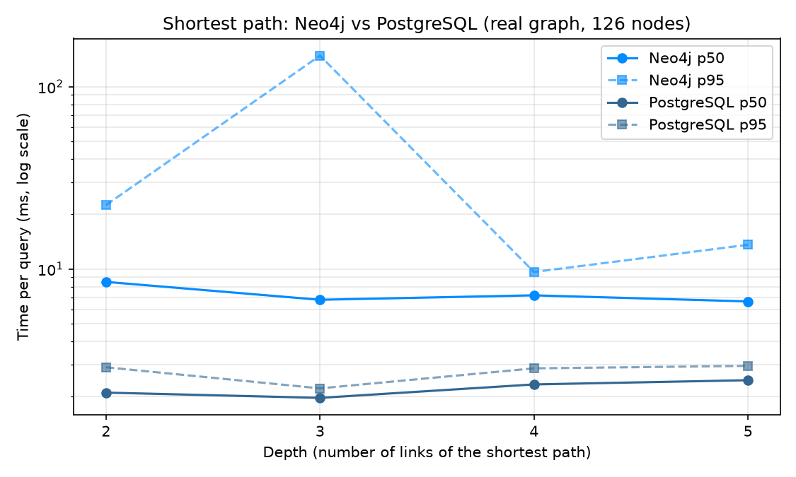
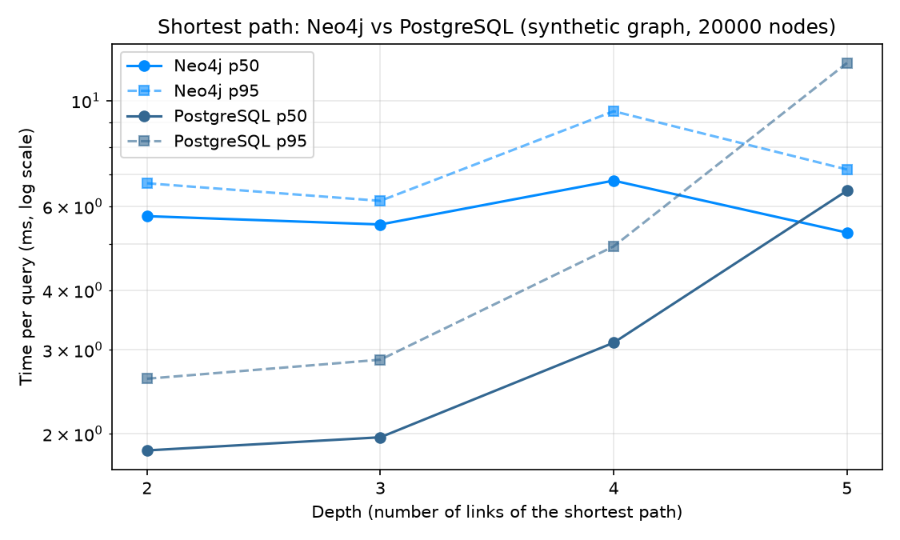

# Pinakes 2.0 : rapport, sections 4 à 6 (brouillon de Hadil)

> Brouillon écrit pour être complété. Chaque `[A REMPLIR : ...]` est un chiffre, une capture ou une
> phrase à remplacer par ce que **vous avez réellement mesuré**. Les chiffres viennent de
> `python scripts/report_numbers_b.py --cassandra-count` et des fichiers
> `benchmarks/neo4j_vs_postgres/results/`. Relisez tout avec vos mots : c'est votre rapport.
> Quand il ne reste plus aucune marque, supprimez ce bloc.

---

## 4. Le graphe d'influences (Neo4j)

### 4.1 Pourquoi un graphe

Une question comme « comment Dante est-il relié à Homère ? » ne porte pas sur une œuvre, mais sur
les **liens entre auteurs**. Dans un catalogue classique, il faudrait enchaîner des jointures. Dans
un graphe, les liens sont des objets de première classe : on part d'un auteur et on suit les liens.
C'est la raison du choix de Neo4j pour la partie « qui a influencé qui ».

### 4.2 Les données

Le graphe contient des **auteurs**, des **œuvres** et des **genres**, reliés ainsi :

```
(Auteur)-[:WROTE]->(Oeuvre)-[:IN_GENRE]->(Genre)
(Auteur)-[:INFLUENCED_BY]->(Auteur)     X a été influencé par Y
(Auteur)-[:STUDENT_OF]->(Auteur)        X a été l'élève de Y
```

Les deux types de liens d'influence pointent **vers celui qui influence** (ou qui enseigne). Ce choix
sert le PageRank : plus un auteur est « pointé » par des auteurs importants, plus son score monte.
Chaque lien porte un champ `origin` qui dit d'où il vient :

| Origine | Sens | Nombre |
|---|---|---|
| `curated` | liens écrits à la main (par exemple Aristote élève de Platon) | [A REMPLIR : nombre] |
| `wikidata` | requête SPARQL sur les propriétés P737 (« influencé par ») et P1066 (« élève de ») | [A REMPLIR : nombre] |
| `generated` | générés à partir des sujets et des genres communs, l'auteur le plus ancien en premier | [A REMPLIR : nombre] |

Au total, le graphe compte [A REMPLIR : nombre d'auteurs] auteurs (dont [A REMPLIR : nombre]
« externes », comme Socrate, qui n'ont pas d'œuvre dans le catalogue mais servent de relais),
[A REMPLIR : nombre] œuvres, [A REMPLIR : nombre] genres et [A REMPLIR : nombre] liens d'influence.

**Limite à dire honnêtement.** Les liens `generated` sont une heuristique (deux auteurs qui partagent
un sujet, l'un né avant l'autre), pas de l'histoire. Ils servent à rendre le graphe assez dense pour
les démonstrations et les mesures. Il faut le préciser quand on commente un chemin.

### 4.3 Chemin le plus court et PageRank

**Chemin le plus court.** La requête Cypher cherche le plus court chemin entre deux auteurs, sans
tenir compte du sens des liens, avec une borne de 8 liens :

```cypher
MATCH (a:Author {id: $a}), (b:Author {id: $b})
MATCH p = shortestPath((a)-[:INFLUENCED_BY|STUDENT_OF*..8]-(b))
RETURN p
```

[A REMPLIR : capture d'écran de Neo4j Browser, ou de la page Graph, montrant un chemin. Exemple :
Horace, Virgile, Homère.]

**PageRank.** Nous mesurons l'influence avec la formule vue en cours :

```
PR(v) = (1 - d) / N + d * somme sur u -> v de PR(u) / L(u)        avec d = 0,85
```

N est le nombre d'auteurs, `L(u)` le nombre de liens sortants de u. Les auteurs sans lien sortant
partagent leur score avec tout le monde (sinon le score se perd). Nous calculons le PageRank en
Python, par itérations successives jusqu'à ce que le changement soit inférieur à 1e-10, sur les
liens lus dans Neo4j. Les scores somment donc à 1.

| Rang | Auteur | Score |
|---|---|---|
| 1 | [A REMPLIR : nom] | [A REMPLIR : score] |
| 2 | [A REMPLIR : nom] | [A REMPLIR : score] |
| 3 | [A REMPLIR : nom] | [A REMPLIR : score] |
| 4 | [A REMPLIR : nom] | [A REMPLIR : score] |
| 5 | [A REMPLIR : nom] | [A REMPLIR : score] |

[A REMPLIR : une phrase d'interprétation. Le classement change quand le graphe grandit (l'auteur
en tête avec 20 œuvres n'est plus le même avec 300). Dites-le si vous l'avez observé, et dites que
le score dépend des liens générés.]

### 4.4 Où se place Neo4j sur le triangle CAP

Le théorème CAP (Brewer, 2000 ; preuve de Gilbert et Lynch, 2002) dit qu'un système distribué ne peut
pas garantir à la fois la cohérence (C), la disponibilité (A) et la tolérance aux partitions (P). Quand
le réseau se coupe, il faut choisir entre C et A. Ces étiquettes sont discutées : elles décrivent une
configuration, pas un produit.

- **Notre déploiement** : une seule instance Neo4j. Il n'y a pas de partition possible, donc on ne
  « choisit » rien. On est dans le cas **CA** : cohérence forte (transactions ACID) et disponibilité tant
  que la machine tourne.
- **En cluster** (réplication « causal clustering », protocole Raft) : Neo4j privilégie la cohérence. Les
  écritures passent par un leader élu à la majorité ; la partie minoritaire d'un réseau coupé ne peut plus
  écrire. C'est donc plutôt **CP**.
- **Pourquoi c'est un bon choix pour nous** : un graphe d'influences est écrit rarement et lu souvent,
  et un lien faux ou manquant est plus gênant qu'une courte indisponibilité.

### 4.5 Benchmark : Neo4j contre PostgreSQL

**Question.** Un plus court chemin est-il vraiment plus rapide dans une base de graphe que dans une base
relationnelle ?

**Méthode.**
- Les deux bases reçoivent **la même copie** du graphe (nœuds `BNode` et liens `BLINK` dans Neo4j ;
  table `bench_adj(a, b)` avec un index sur `a` dans PostgreSQL). Les liens sont non orientés pour les
  deux. Le vrai graphe du projet n'est pas touché.
- Pour chaque profondeur de 2 à 5, un programme choisit [A REMPLIR : nombre, 10 par défaut] paires
  d'auteurs dont le plus court chemin fait **exactement** cette longueur (calculé par un parcours en
  largeur en Python, vérifié ensuite par les deux bases : le nombre de réponses fausses doit être 0).
- Neo4j : `shortestPath` borné à la profondeur de la paire.
- PostgreSQL : une requête récursive `WITH RECURSIVE` qui garde le chemin parcouru dans un tableau pour
  éviter les cycles, limitée à la profondeur de la paire, avec `LIMIT 1` pour s'arrêter au premier
  résultat.
- 30 mesures par profondeur et par base, après 3 mesures d'échauffement non comptées. Le temps est mesuré
  côté client (il inclut donc le réseau local et la lecture de la réponse).
- On donne **p50** (le temps typique) et **p95** (95 % des requêtes vont plus vite). Avec 30 mesures, le
  p95 se situe entre la 3e et la 2e plus lente : il faut le lire avec prudence.
- Deux graphes : le **vrai graphe** ([A REMPLIR : nombre] auteurs, [A REMPLIR : nombre] liens) et un
  **graphe synthétique** de 20 000 nœuds, parce qu'un graphe de quelques centaines d'auteurs est trop
  petit pour voir une différence.

**Résultats.** [A REMPLIR : coller ici le contenu de `benchmarks/neo4j_vs_postgres/results/real/results.md`
puis celui de `.../synthetic/results.md`.]





**Lecture.** [A REMPLIR : écrivez ce que vos mesures montrent, pas ce qu'on attend d'elles. Pistes selon
ce que vous trouvez :
- *PostgreSQL aussi rapide que Neo4j, voire plus rapide, sur le vrai graphe.* C'est plausible : avec
  quelques centaines d'auteurs, tout tient en mémoire et les deux sont à la milliseconde. Dites-le, et
  appuyez-vous sur le graphe synthétique.
- *L'écart grandit avec la profondeur ou avec la taille.* La requête récursive explore tous les chemins
  jusqu'à la profondeur demandée (leur nombre croît comme le degré moyen puissance la profondeur), alors
  que `shortestPath` fait un parcours en largeur qui ne visite chaque nœud qu'une fois. Montrez le
  rapport PostgreSQL / Neo4j par profondeur.
- *Des délais dépassés (timeouts) côté PostgreSQL.* Notez-les : c'est un résultat.]

**Limites.** Tout tourne sur un seul ordinateur, dans Docker, avec des caches chauds. Une requête SQL plus
astucieuse (un parcours en largeur écrit avec `UNION`, ou une fonction PL/pgSQL) irait plus vite que
notre requête récursive « naturelle ». Nous comparons donc ce qu'écrirait un développeur SQL sans
astuce avec ce qu'écrit un développeur Cypher. Nous n'avons mesuré ni les écritures, ni plusieurs
utilisateurs en même temps.

---

## 5. Cassandra : les événements de lecture

### 5.1 Le besoin

Chaque fois qu'une personne ouvre une œuvre, la page Streamlit envoie `POST /events/read`. C'est un
flux d'écritures qui ne s'arrête jamais, qu'on relit de deux façons : « combien de lectures de cette
œuvre ce jour-là ? » et « qu'a lu cette personne récemment ? ». Cassandra est conçue pour ce cas :
beaucoup d'écritures, des lectures prévisibles.

### 5.2 Une table par question

Dans Cassandra, on ne conçoit pas les tables à partir des données mais **à partir des questions**. Il n'y
a ni jointure ni index secondaire utile : chaque question lit **une seule partition**.

| Question | Table | Clé de partition | Tri dans la partition |
|---|---|---|---|
| Lectures de l'œuvre W le jour D ? | `reads_by_work_day` | (work_id, day) | ts décroissant, user_id |
| Que lit l'utilisateur U ? | `reads_by_user` | user_id | ts décroissant, work_id |

```sql
CREATE TABLE pinakes.reads_by_work_day (
  work_id text, day date, ts timestamp, user_id text,
  PRIMARY KEY ((work_id, day), ts, user_id)
) WITH CLUSTERING ORDER BY (ts DESC, user_id ASC);
```

Chaque événement est donc **écrit deux fois** (une fois par table). Cette duplication est normale
dans Cassandra : on paie à l'écriture (qui est peu coûteuse, stockage en journal) pour lire vite.
Le jour fait partie de la clé de partition, pour qu'une œuvre très lue ne crée pas une partition
géante. **Limite** : la partition d'un utilisateur grandit sans fin ; dans un vrai système, on
ajouterait le mois à la clé.

### 5.3 Les données et l'API

Nous avons généré [A REMPLIR : nombre, 100 000 par défaut] événements sur 30 jours, pour 500
utilisateurs. La popularité des œuvres suit une loi de Zipf (1 / rang) : quelques œuvres sont très
lues, la plupart peu, comme dans la réalité. Les trois endpoints : `POST /events/read` (201),
`GET /events/work/{id}?day=...`, `GET /events/user/{id}?limit=...`.

[A REMPLIR : capture d'écran de la page Events : lectures par jour sur 7 jours, enregistrement d'une
lecture, historique d'un utilisateur.]

### 5.4 Où se place Cassandra sur le triangle CAP

Cassandra est classée **AP** : elle reste disponible pendant une partition (n'importe quel nœud
répond) et accepte une cohérence **à terme** : les copies se rattrapent ensuite. Cette classification
est **réglable** : pour une opération on choisit un niveau de cohérence. Avec N copies, si on lit
sur R nœuds et on écrit sur W nœuds, la lecture voit la dernière écriture quand `R + W > N`
(par exemple QUORUM en écriture et en lecture).

Dans notre projet, il y a **un seul nœud** et un facteur de réplication de 1, et nous utilisons le
niveau `ONE`. Nous n'avons donc pas de partition à gérer, et il faut le dire : le choix AP décrit ce
que Cassandra ferait en cluster, pas ce que nous avons exécuté. Il est pourtant adapté : perdre
ou retarder quelques événements de lecture est sans gravité, alors que refuser des écritures
quand le réseau est coupé serait pire.

---

## 6. Logs, ELK et détection d'anomalies

### 6.1 Le chemin d'un log

```
requête HTTP -> API FastAPI (une ligne JSON par requête dans logs/api.log)
  -> Filebeat (lit le fichier) -> Logstash (filtres) -> Elasticsearch (logs) -> Kibana
```

- Le **middleware** de l'API écrit pour chaque requête : date, adresse IP du client, méthode, chemin,
  code de statut, durée en millisecondes.
- **Logstash** remplace la date d'arrivée par la date écrite par l'API, convertit les types (`status`
  en entier, `latency_ms` en nombre décimal) et ajoute la localisation de l'IP (`geoip`).
- Un **modèle d'index** fixe les types dans Elasticsearch : `client_ip` est de type `ip`,
  `geoip.location` est un `geo_point` (nécessaire pour la carte).
- Les index sont **quotidiens** (`pinakes-logs-AAAA.MM.JJ`), et une politique de cycle de vie
  les supprime après **7 jours**.

### 6.2 Le dashboard Kibana

Cinq panneaux : requêtes par minute, codes de statut, requêtes les plus lentes, adresses IP les plus
actives, carte des clients. Il est exporté dans `elk/dashboard.ndjson` et peut être réimporté avec
`python elk/dashboard_io.py import`.

[A REMPLIR : capture du dashboard en fonctionnement normal.]

[A REMPLIR : capture du dashboard pendant la rafale du robot : pic dans « Requests per minute »,
l'IP du robot en tête de « Top client IPs ».]

### 6.3 Détecter un robot avec un z-score

Un visiteur normal fait quelques requêtes par minute, un robot en fait des centaines. Pour chaque
couple (adresse IP, minute) sur les 30 dernières minutes, on compte les requêtes x, et on calcule

```
z = (x - moyenne) / écart-type          alerte si z > 3
```

La moyenne et l'écart-type portent sur tous les couples de la fenêtre. Un z supérieur à 3 signifie que
x est à plus de trois écarts-types au-dessus de la moyenne : pour des comptes qui suivent à peu près une
loi normale, cela arrive pour environ 0,1 % des couples, donc les alertes sont rares.

Quatre garde-fous, et pourquoi :
- au moins **10 couples** (IP, minute) : avec trop peu d'historique, « normal » n'est pas défini ;
- si l'écart-type vaut 0, z n'est pas défini : pas d'alerte ;
- au moins **20 requêtes** : évite d'alerter pour 5 requêtes quand les autres en font 1 ;
- seules les **3 dernières minutes** sont signalées, et il y a **un seul document d'alerte par couple**
  (IP, minute), pour ne pas répéter la même alerte à chaque vérification (toutes les 20 secondes).

Test : `bot_simulator.py` envoie du trafic normal depuis 25 adresses, puis une rafale de 300 requêtes
depuis une seule. [A REMPLIR : combien de temps après la rafale l'alerte est apparue ; valeurs de
l'alerte : requêtes par minute, z, moyenne, écart-type. Voir `GET /monitoring/alerts`.]

[A REMPLIR : capture de la page Monitoring avec l'alerte.]

**Limites.** (1) La rafale elle-même augmente la moyenne et l'écart-type, donc elle paraît un peu
moins extrême qu'elle ne le serait face à un historique « propre » ; avec un seul point aberrant parmi
n couples, z ne peut pas dépasser environ racine de n, d'où le minimum de 10 couples. (2) Un robot lent,
ou un robot qui change d'adresse IP, passe inaperçu. (3) Le z-score suppose des comptes à peu près en
forme de cloche, alors que le trafic réel est très dissymétrique : une version plus robuste utiliserait
la médiane et l'écart absolu médian.

### 6.4 CAP pour Elasticsearch (logs)

Même raisonnement que pour l'Elasticsearch du catalogue (section 3) : un seul nœud, aucun réplica, donc
pas de partition possible. En cluster, Elasticsearch élit un nœud maître à la majorité, ce qui la place
plutôt du côté **CP** pour les écritures, avec une lecture « quasi temps réel » (les documents deviennent
cherchables après un rafraîchissement, environ une seconde). Pour des logs, un retard de quelques
secondes ne gêne pas.

---

## Conclusion de la partie B

[A REMPLIR : 5 à 8 lignes avec vos mots. Ce que chaque base a apporté (Neo4j : chemins et influence ;
Cassandra : écritures massives ; ELK : visibilité et alertes), ce qui a été le plus difficile (par
exemple Docker, la mémoire, le réglage des types dans Elasticsearch), ce que vous feriez avec plus de
temps (réplication de Cassandra, version robuste du z-score, vraies données d'influence).]

## Références à citer (vérifiez chaque référence avant de la mettre)

- Brewer, E. (2000). *Towards robust distributed systems* (conjecture CAP).
- Gilbert, S. et Lynch, N. (2002). *Brewer's conjecture and the feasibility of consistent, available,
  partition-tolerant web services*.
- Page, L., Brin, S., Motwani, R., Winograd, T. (1999). *The PageRank citation ranking*.
- Documentation officielle : Neo4j (Cypher, `shortestPath`), Apache Cassandra (modélisation par
  requêtes, niveaux de cohérence), Elastic (Filebeat, Logstash, Kibana, ILM).
